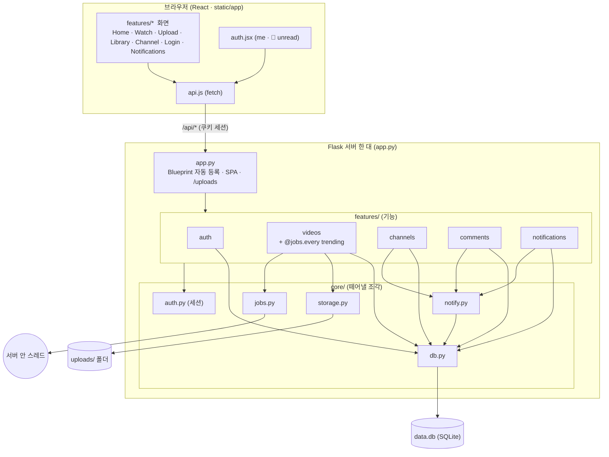

# 5주차 · 미션 1 — 원본(tube-lite) 코드 구조 분석과 아키텍처 V2 비교

> 원본: `tube-lite.zip` (TubeLite · 유튜브 클론) · Flask(JSON API) + React(Vite) 모놀리식
> 분석 기준: **원본 그대로의 상태** (미션 3에서 추가한 파일은 미션 2 문서 참고)

---

## 1. 로컬 실행 확인

```bash
cd tube-lite
python -m venv .venv
.venv\Scripts\activate            # macOS/Linux: source .venv/bin/activate
set PYTHONUTF8=1                  # ← Windows 필수 (아래 '막혔던 점' 참고)
python -m pip install -r requirements.txt
copy .env.example .env
python seed.py                    # kim / lee / park / choi · 비밀번호 1234 · 동영상 12개
python app.py                     # http://localhost:5000
```

서버 로그에서 확인한 것:

```
[app] 기능 등록: /api/auth · /api/channels · /api/comments · /api/notifications · /api/videos
[db] SQLite ...\tube-lite\data.db — 이 파일이 지워지면 데이터도 사라집니다
[jobs] 등록: trending (every 86400s)
```

**막혔던 점 (조원 공유용)**

| 증상 | 원인 | 해결 |
|---|---|---|
| `pip install -r requirements.txt` → `UnicodeDecodeError: 'cp949'` | requirements.txt 안의 한글 주석을 Windows 기본 인코딩(cp949)으로 읽음 | `set PYTHONUTF8=1` (PowerShell: `$env:PYTHONUTF8=1`) 후 설치 |
| 설치했는데 `No module named 'werkzeug'` | `pip` 와 `python` 이 서로 다른 버전(3.13 / 3.12)을 가리킴 | `.venv` 를 만들고 `python -m pip` 로 설치 |
| seed 를 두 번 돌리니 동영상이 24개 | `seed.py` 는 기존 데이터를 지우지 않음 | 서버를 끄고 `data.db*` 와 `uploads/*` 를 지운 뒤 seed |
| `data.db` 가 안 지워짐 (busy) | 서버(python)가 파일을 잡고 있음 | 서버를 먼저 종료 |

---

## 2. 파일 구조 (원본)

```
tube-lite/
├─ app.py                  진입점. features/*/api.py 를 /api/<이름> 으로 자동 등록 · /uploads 서빙 · React SPA 서빙
├─ seed.py                 데모 데이터 (채널 4 · 동영상 12 · 구독 · 좋아요 · 댓글 · 인기 집계)
├─ requirements.txt        Flask · python-dotenv  (6주차부터 boto3)
├─ .env.example            SECRET_KEY · PORT · (주석) STORAGE/DB/NOTIFY_BACKEND
│
├─ core/                   ★ "클라우드로 떼어낼 조각" — 기능 코드는 이것만 부른다
│  ├─ storage.py           파일 저장  save · put_bytes · url · delete     → uploads/ 폴더     (6주차 S3)
│  ├─ db.py                데이터     put · get · find · all · update · delete → SQLite data.db (7주차 DynamoDB)
│  ├─ notify.py            알림       send · unread_count · mark_all_read → notifications 테이블 (9주차 SNS+Lambda)
│  ├─ jobs.py              주기작업   @every · start · run_now          → 서버 안 스레드   (9주차 EventBridge+Lambda)
│  └─ auth.py              로그인 상태 current_user · login_required     → 서명된 쿠키 세션  (마무리 강의)
│
├─ features/               ★ 기능 = 폴더 하나 = Blueprint 하나 (/api/<폴더명>/…)
│  ├─ auth/api.py          가입 · 로그인 · 로그아웃 · me                    users
│  ├─ videos/api.py        목록·검색 · 업로드 · 시청(조회수+1·기록) · 좋아요/싫어요 · 보관함 · 인기 집계(job)
│  │                                                                     videos · history · trending
│  ├─ channels/api.py      채널 · 구독 토글(→notify) · 구독 목록            subscriptions
│  ├─ comments/api.py      댓글(→notify) · 댓글 좋아요                      comments
│  ├─ notifications/api.py 알림함 · 모두 읽음                               notifications
│  └─ _template/           새 기능 복사용 (자동 등록 제외)
│
├─ frontend/               React 18 + react-router 6 + Vite 5
│  └─ src/
│     ├─ main.jsx · App.jsx        라우터 · AuthProvider · Layout
│     ├─ api.js                    fetch 래퍼 (서버와 이야기하는 유일한 통로)
│     ├─ auth.jsx                  로그인 상태 Context (me · unread · login/signup/logout)
│     ├─ format.js                 "조회수 1.2만회 · 3일 전" 표기
│     ├─ styles.css                유튜브 다크 테마
│     ├─ components/               Layout(상단바·사이드바) · VideoCard/VideoRow · Avatar · Icons · ui · RequireLogin
│     └─ features/                 ★ 백엔드와 같은 이름의 폴더, routes.jsx 를 index.js 가 자동 수집
│        ├─ videos/                Home · Results · Watch · Upload · Library
│        ├─ channels/              Channel · Subscriptions
│        ├─ auth/                  Login · Signup
│        ├─ notifications/         Notifications
│        └─ _template/
│
├─ static/app/             npm run build 결과 (Flask 가 그대로 서빙 → Node 없이 실행 가능)
└─ uploads/                업로드 파일 (서버가 꺼지면/옮기면 사라지는 상태)
```

### 핵심 설계 규칙 2가지

1. **자동 등록** — `features/` 에 폴더를 추가하면 `app.py` 가 `/api/<폴더명>` 으로, `frontend/src/features/index.js` 가 `routes.jsx` 를 라우터·사이드바에 붙인다. **app.py · App.jsx 를 고칠 필요가 없다.**
2. **core 를 통해서만** — 기능은 파일·데이터·알림·주기작업을 `core/` 함수로만 쓴다. 그래서 `core/storage.py` 한 파일을 S3 판으로 바꾸면 **모든 기능(조가 추가한 기능 포함)** 의 파일이 같은 날 S3 로 간다.

---

## 3. 코드 구조도



### 요청 한 번 따라가기 — 시청 페이지 `GET /api/videos/<id>`

```
Watch.jsx ─ api.get('/api/videos/abc') ─▶ app.py ─▶ features/videos/api.py: watch()
   ├─ db.get('videos', id)                      영상
   ├─ db.update('videos', id, views=+1)         조회수 (영상 문서 안의 필드)
   ├─ db.put('history', {uid_vid, at})          로그인 상태일 때만 시청 기록
   ├─ db.find('comments', video_id=id)          댓글 (Scan 성격)
   ├─ channel_of() → db.find('subscriptions')   구독자 수
   └─ storage.url(file/thumb)                   /uploads/… 주소
```

### 데이터 모델 (db.py 테이블 = 키-값 문서, 조인 없음)

| 테이블 | id | 주요 필드 | 비고 |
|---|---|---|---|
| users | 아이디(=채널 핸들) | name · pw(해시) · color · bio | |
| videos | uuid 12자 | uploader · title · desc · file · thumb · duration · **views** · **likes[]** · **dislikes[]** | 좋아요/싫어요/조회수가 **영상 문서 안에** 있다 |
| comments | uuid | video_id · author · text · likes[] | |
| subscriptions | `구독자_채널` | sub · channel | id 로 중복 방지 |
| history | `uid_vid` | uid · vid · at | 같은 영상은 한 줄, 시각만 갱신 |
| trending | `today` | ids[] | 주기 작업 결과 |
| notifications | uuid | user_id · subject · body · link · read | |

---

## 4. 서비스 아키텍처 V2 와 비교

| V2 구성요소 (그림) | V2 가 맡는 일 | 원본 코드에서 그 일을 하는 곳 | 차이 · 판단 |
|---|---|---|---|
| **CloudFront** | CDN · HTTPS · 정적 콘텐츠 전달 | `app.py` 의 `spa()` · `/uploads` 라우트 | 원본은 Flask 가 직접 서빙. S3 로 옮긴 뒤(6주차) 앞에 붙이면 된다 → **선택 과제** |
| **S3** | 프론트 정적 파일 · 영상 · 썸네일 | `static/app/` · `core/storage.py` → `uploads/` | **일치.** storage.py 한 파일 교체(6주차). 정적 호스팅은 선택 과제 |
| **Cognito** | 회원가입 · 로그인 · 토큰 발급 | `features/auth` + `core/auth.py` (비밀번호 해시 + 서명된 쿠키) | **불일치.** 원본은 세션 쿠키 방식. Cognito 로 가면 auth.jsx(토큰 보관)·core/auth.py(토큰 검증)를 바꿔야 한다 → 강의 계획에 없음, **후순위** |
| **API Gateway + Lambda** | REST 진입점 · 백엔드 로직 | `app.py` + `features/*/api.py` (Flask Blueprint) | **불일치.** 강의는 10주차에 Flask 를 **EC2** 로 올린다. V2 처럼 서버리스로 가려면 Blueprint 를 Lambda 로 감싸야 함 → 우선 EC2, 여유 있으면 확장 |
| **RDS / Aurora** | User · Video · Comment · Channel · 메타데이터 (관계형) | `core/db.py` (키-값 문서, **조인 없음**) | **불일치.** db.py 인터페이스는 DynamoDB 에 맞춰 설계됨. V2 대로 RDS 를 쓰려면 db.py 를 둘로 쪼개야 함 → **강의 계획대로 전부 DynamoDB** 권장, V2 수정 |
| **DynamoDB** | Like · Dislike · Subscription · WatchHistory · ViewCount | `core/db.py` 의 subscriptions · history + **videos 문서 안의 likes/dislikes/views** | 부분 일치. 좋아요·조회수는 별도 테이블이 아니라 영상 문서 필드 → V2 그림을 코드에 맞게 고치거나, 인기 영상의 동시 쓰기 문제를 7주차 반박 소재로 |
| **OpenSearch** | 검색 · 필터링 · 정렬 · 인덱스 | `videos/api.py index()` 의 **부분 문자열 검색** + 정렬 칩 3개 | **원본에 없음** → 미션 2·3 에서 `core/search.py` 조각 + 필터 UI 추가 |
| **Browser Local Storage** | 인증 토큰 · 임시 상태 · **비로그인 시청기록** | 없음 (쿠키 세션, 시청 기록은 로그인 필수) | **원본에 없음** → 미션 2·3 에서 비로그인 시청 기록 추가 |
| *(V2 에 없음)* | 댓글 · 구독 알림 | `core/notify.py` ← comments · channels | V2 에 **SNS + Lambda** 추가 필요 (9주차) |
| *(V2 에 없음)* | 매일 인기 동영상 집계 | `core/jobs.py` ← `videos.compute_trending` | V2 에 **EventBridge + Lambda** 추가 필요 (9주차) |
| *(V2 에 없음)* | 서버 실행 · 권한 · 로그 | `app.py` 단일 프로세스 | V2 에 **EC2(10주차) · IAM · CloudWatch Logs** 추가 필요 |

### 한 줄 결론

- V2 의 **S3 · DynamoDB** 는 원본의 `core/storage.py` · `core/db.py` 와 1:1 로 맞는다 → 강의 흐름 그대로 간다.
- V2 에만 있는 **OpenSearch · Local Storage** 는 원본에 기능 자체가 없다 → **우리 조의 추가 기능**이 된다 (미션 2·3).
- V2 에 빠진 **SNS · EventBridge · EC2 · IAM · CloudWatch** 를 V3 에 추가하고, **RDS/Aurora · Cognito · API Gateway** 는 "선택/후순위" 로 표시한다.

---

## 5. 클라우드화 순서 계획

| 주차 | 떼어낼 조각 | 바꾸는 파일 | AWS | 성공 기준 |
|---|---|---|---|---|
| 5 | 준비 | `.env` | IAM 사용자 `team-N` · `aws configure` | `aws sts get-caller-identity` 가 team-N 으로 뜸 |
| 6 | 파일 | `core/storage.py` | S3 (비공개 · 프리사인 URL) | `uploads/` 를 지워도 썸네일이 보임 |
| 7 | 데이터 | `core/db.py` | DynamoDB (테이블 자동 생성) | `data.db` 를 지워도 데이터가 남음 · **playlists 테이블도 자동으로 같이 감** |
| 9 | 알림 · 주기작업 | `core/notify.py` · `core/jobs.py` | SNS · Lambda · EventBridge | 서버를 꺼도 인기 집계가 돎 · 댓글 알림 메일 |
| 10 | 남은 서버 | (코드 변경 없음) | EC2 + IAM 역할 | 노트북 액세스 키 삭제 후에도 동작 |
| 선택 | 화면 | `static/app/` | S3 정적 호스팅 + CloudFront | V2 그림의 CloudFront 구간 |
| 선택 | 검색 (조 기능) | `core/search.py` | OpenSearch + DynamoDB Streams → Lambda 색인 | V2 그림의 OpenSearch 구간 · **비용 주의** |

## 6. AWS 자격 증명을 노트북에 안전하게

- 루트 계정 키는 만들지 않는다. 조 대표 계정에 **IAM 사용자 `team-N`** 을 만들고 `core-aws/iam/student-policy.json` (TEAM-PREFIX · ACCOUNT-ID · REGION 교체) 만 붙인다.
- 키는 `aws configure --profile team-N` 으로 **`~/.aws/credentials` 에만** 둔다. `.env` 에는 버킷 이름·리전 같은 **이름만** 적는다 (`.env` 는 이미 `.gitignore` 에 있음).
- 키를 카톡·노션·코드·스크린샷에 올리지 않는다. 올렸다면 즉시 IAM 콘솔에서 **비활성화 → 삭제 → 재발급**.
- 10주차 EC2 로 옮기면 **인스턴스 역할**을 쓰고 노트북의 액세스 키는 삭제한다.
