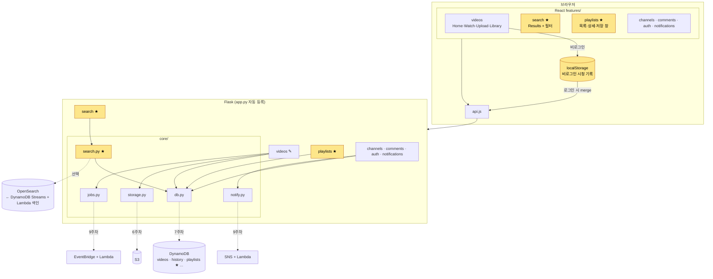

# 5주차 · 미션 2 — 추가 기능 설계와 새 파일 구조도

회의에서 정한 추가 기능 3가지를 **원본의 두 규칙**(① 기능 = 폴더 하나, ② 파일·데이터는 `core/` 로만)에 맞춰 넣는다.

| # | 기능 | 왜 (아키텍처 V2 근거) | 새 폴더 / 조각 | 나중에 갈 AWS |
|---|---|---|---|---|
| 1 | **검색 필터 · 정렬** (+ 카테고리 · #해시태그) | V2 의 *OpenSearch: 검색/필터링/정렬* 이 원본엔 부분 문자열 검색뿐 | `core/search.py` (새 조각) · `features/search/` | OpenSearch (선택) |
| 2 | **비로그인 시청 기록** | V2 의 *Browser Local Storage: 비로그인 시청기록* | `frontend/src/localHistory.js` · videos API 2개 | 서버 없음 (브라우저) |
| 3 | **재생목록 · 나중에 볼 동영상** | V2 *DynamoDB* 의 사용자 행동 데이터 확장 | `features/playlists/` | DynamoDB (7주차 자동) |

---

## 1. 기능별 설계

### ① 검색 필터 · 정렬 — `core/search.py` 를 새 조각으로

원본 `core/` 에 **검색 조각을 하나 더** 만든다. 기능 코드는 `search.query()` 만 부르므로, 나중에 이 파일만 OpenSearch 판으로 바꾸면 된다 (storage/db 와 같은 방식).

```python
search.query('videos', '자료구조 #알고리즘',
             fields={'title': 3, 'tags': 3, 'uploader_name': 2, 'desc': 1},   # 가중치 → 관련성 점수
             ranges={'created_at': (일주일전, None), 'duration': (240, 1200)}) # 범위 필터
```

| 필터 | 값 | 구현 |
|---|---|---|
| 업로드 날짜 | 지난 1시간 · 오늘 · 이번 주 · 이번 달 · 올해 | `created_at` 범위 |
| 길이 | 4분 미만 · 4~20분 · 20분 초과 | `duration` 범위 |
| 카테고리 | 브이로그 · 교육 · 음식 · 테크 · 게임 · 음악 · 기타 | 결과를 센 뒤 거름 → 칩에 개수 표시 |
| 정렬 | 관련성 · 업로드 날짜 · 조회수 · 좋아요 | 점수 / 필드 정렬 |
| 해시태그 | 검색어 `#자료구조` | `tags` 필드 정확히 일치 |

- 업로드할 때 **카테고리 선택** + 제목·설명의 `#태그` 를 뽑아 `videos.category` · `videos.tags` 에 저장
- 시청 페이지 제목 위에 `#태그` 링크 (유튜브처럼) → 누르면 태그 검색
- 필터 상태는 **주소(`/results?q=&date=&duration=&sort=&category=`)** 에 둠 → 뒤로가기·링크 공유 가능
- 홈에도 카테고리 칩

**API** `GET /api/search/?q=&sort=&date=&duration=&category=` → `{items, total, categories:{카테고리: 개수}}`

### ② 비로그인 시청 기록 — 브라우저에만 저장, 로그인하면 합치기

```
[비로그인] Watch.jsx ──localHistory.add(id)──▶ localStorage 'tubelite.history' = [{vid, at}, …] (최신순 · 최대 100)
[비로그인] /history ──GET /api/videos/by-ids?ids=a,b,c──▶ 영상 정보만 서버에서
[로그인 순간] auth.jsx ──POST /api/videos/history/merge {items}──▶ history 테이블에 합침 (더 최근 시각 우선) → localStorage 비움
```

- 서버는 비로그인 사용자를 **기억하지 않는다** (상태 없음) → 서버가 여러 대가 되어도 문제없음
- 사이드바의 *내 동영상 · 좋아요 · 재생목록* 은 로그인해야 보이게(`nav` 에 `auth: true`), *시청 기록* 은 누구나

### ③ 재생목록 · 나중에 볼 동영상 — `features/playlists/`

`_template` 을 복사해 만든 **완전히 새 기능 폴더**. 데이터는 `core.db` 로만 쓰므로 7주차에 `team-N-playlists` DynamoDB 테이블로 코드 변경 없이 간다.

| 필드 | 설명 |
|---|---|
| id | uuid · 나중에 볼 동영상은 `WL_<아이디>` (사람마다 하나, 삭제 불가) |
| owner · title | 주인 · 제목 |
| kind | `normal` · `watch_later` |
| visibility | `private`(나만) · `public`(링크가 있는 누구나) |
| video_ids[] | 최근 담은 순 · 최대 500 (DynamoDB 항목 400KB 제한 고려) |
| updated_at | 목록 정렬용 |

| 메서드 | 경로 | 하는 일 |
|---|---|---|
| GET | `/api/playlists/` | 내 재생목록 (나중에 볼 동영상이 맨 앞) |
| POST | `/api/playlists/` | 만들기 `{title, visibility, video_id?}` |
| GET | `/api/playlists/saved/<video_id>` | 저장 창용 — 이 영상이 들어 있는지 |
| GET | `/api/playlists/<id>` | 재생목록 + 영상들 (`WL` = 내 나중에 볼 동영상 · 비공개는 주인만) |
| POST | `/api/playlists/<id>/toggle` | 영상 넣기/빼기 |
| POST | `/api/playlists/<id>/delete` | 삭제 |

화면: 시청 페이지 **저장** 버튼 → 체크박스 창(＋ 새 재생목록) · 사이드바 *재생목록* · *나중에 볼 동영상* · 재생목록 상세(모두 재생 · 공유 · 영상 빼기 · 삭제)

---

## 2. 새 파일 구조도 (★ 새 파일 · ✎ 고친 파일)

```
tube-lite/
├─ app.py                         (그대로 — 새 기능은 자동 등록)
├─ seed.py                      ✎ 카테고리 · #태그 · 데모 재생목록 2개(kim)
├─ docs/                        ★ 5주차 미션 문서
│
├─ core/
│  ├─ storage.py · db.py · notify.py · jobs.py · auth.py   (그대로)
│  └─ search.py                 ★ 검색 조각  query(table, q, fields, eq, ranges)   → (선택) OpenSearch
│
├─ features/
│  ├─ videos/api.py             ✎ category · tags(extract_tags) · ?category= · /categories · /by-ids · /history/merge
│  ├─ search/api.py             ★ GET /api/search/  필터 · 정렬 · 카테고리 개수
│  ├─ playlists/api.py          ★ 재생목록 · 나중에 볼 동영상 (playlists 테이블)
│  └─ auth · channels · comments · notifications · _template   (그대로)
│
└─ frontend/src/
   ├─ localHistory.js           ★ 비로그인 시청 기록 (localStorage)
   ├─ auth.jsx                  ✎ 로그인·가입 직후 브라우저 기록 → 서버로 합치기
   ├─ styles.css                ✎ 필터 패널 · 저장 창 · 재생목록 화면
   ├─ components/
   │  ├─ Icons.jsx              ✎ Playlist · WatchLater · PlaylistAdd · Filter · Close · Lock · Globe
   │  └─ Layout.jsx             ✎ 새 아이콘 · 로그인 전용 메뉴(auth: true) 숨김
   └─ features/
      ├─ videos/
      │  ├─ Home.jsx            ✎ 카테고리 칩
      │  ├─ Upload.jsx          ✎ 카테고리 선택 · #태그 안내
      │  ├─ Watch.jsx           ✎ #태그 링크 · 저장 버튼 · 비로그인 기록
      │  ├─ Library.jsx         ✎ 비로그인 시청 기록 화면
      │  ├─ routes.jsx          ✎ /results 를 search 로 이동 · auth 표시
      │  └─ Results.jsx         ✗ 삭제 (search/Results.jsx 로 옮김)
      ├─ search/                ★ routes.jsx · Results.jsx (필터 패널)
      └─ playlists/             ★ routes.jsx · Playlists.jsx · Playlist.jsx · SaveDialog.jsx
```

## 3. 새 구조도



## 4. 클라우드화할 때 이 설계가 주는 것

- **재생목록**: `core.db` 만 쓰므로 7주차 `db.py` 교체 한 번에 `team-N-playlists` 테이블이 자동 생성된다. 추가 작업 없음.
- **검색**: `core/search.py` 가 따로 있어서 OpenSearch 로 갈 때 `features/search` 는 한 줄도 안 바뀐다. 색인은 features 가 아니라 **DynamoDB Streams → Lambda** 가 맡도록 설계 (features 는 지금처럼 `db.put` 만). 단 OpenSearch 는 상시 과금이므로 조 예산 확인 후 결정 — 안 가도 로컬 판이 DynamoDB Scan 위에서 그대로 동작한다.
- **비로그인 시청 기록**: 서버에 상태가 없으므로 10주차 EC2 가 여러 대가 되어도 영향 없음.
